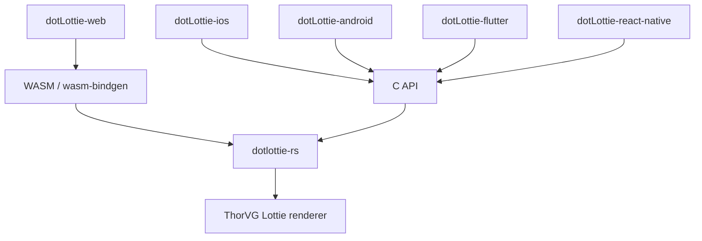

# dotLottie Rust


[](https://crates.io/crates/dotlottie-rs)


<p align="center">
  
</p>

<h1 align="center">dotLottie Rust</h1>

> [!TIP]
> Looking for animations to use with this player? Browse [100,000+ free Lottie animations](https://lottiefiles.com/free-animations?utm_source=npm&utm_medium=readme) and download any of them as `.lottie` or `.json`, or create your own with [Lottie Creator](https://lottiefiles.com/lottie-creator?utm_source=npm&utm_medium=readme).

dotlottie-rs is the [dotLottie](https://lottiefiles.com/dotlottie) runtime, written in Rust.
Every official dotLottie player uses it, so theming, state machines, and multi-animation files behave the same way on every platform.

Native platforms call it through a C API generated with cbindgen. The web player calls it through wasm-bindgen bindings.



## What is dotLottie?

dotLottie is an open-source file format that packs one or more Lottie animations and their assets into a single file.
A `.lottie` file is a ZIP archive compressed with Deflate.

[Learn more about dotLottie](https://lottiefiles.com/dotlottie).

## Features

- One Rust codebase builds for Android, iOS, the web, Flutter, React Native, and desktop.
- All players render with [ThorVG](https://github.com/thorvg/thorvg), so an animation draws the same on every platform.
- Theming overrides slots at runtime. Supported slot types are color, scalar, vector, position, text, gradient, image, and bezier path.
- State machines add interactivity through states, transitions, guards, and actions.
- A single `.lottie` file can hold several animations, and the player can switch between them.
- The `.lottie` reader handles manifest v1 and v2 and embedded assets.
- The `c_api` feature generates a C header with cbindgen for the Android NDK, iOS, and desktop.
- The `wasm-bindgen-api` feature generates WebAssembly bindings for the browser.

## Players

These official players use dotlottie-rs:

- [dotlottie-web](https://github.com/LottieFiles/dotlottie-web)
- [dotlottie-android](https://github.com/LottieFiles/dotlottie-android)
- [dotlottie-ios](https://github.com/LottieFiles/dotlottie-ios)
- [dotlottie-flutter](https://github.com/LottieFiles/dotlottie-flutter)
- [dotlottie-react-native](https://github.com/LottieFiles/dotlottie-react-native)

## Contents

- [Installation](#installation)
- [Crates](#crates)
- [Examples](#examples)
- [Development](#development)
- [License](#license)

## Installation

```sh
cargo add dotlottie-rs
```

dotlottie-rs requires Rust 1.89 or later.
ThorVG ships inside the crate, and the build script compiles it from source.
You need clang to compile ThorVG and libclang for bindgen.

The default features include the ThorVG software renderer with PNG, JPEG, WebP and TTF support, expressions and threads. To choose your own set:

```toml
[dependencies]
dotlottie-rs = { version = "0.1", default-features = false, features = [
    "dotlottie",      # .lottie files
    "state-machines", # state machines
    "theming",        # themes and slots
    "tvg-cpu",        # software rendering backend
    "tvg-png",        # PNG image support
] }
```

## Crates

- [dotlottie-rs](https://github.com/LottieFiles/dotlottie-rs/tree/main/dotlottie-rs) is the core library. It includes the C API (feature `c_api`) and the wasm-bindgen bindings (feature `wasm-bindgen-api`).

## Examples

The examples are in [dotlottie-rs/examples](https://github.com/LottieFiles/dotlottie-rs/tree/main/dotlottie-rs/examples). Run the Rust ones from the `dotlottie-rs` directory with `cargo run --example <name>`.

| Example | Shows |
| --- | --- |
| `player` | Loading `.lottie` and Lottie JSON files, playback controls, themes, background. Add `--features audio` for audio layers. |
| `slots` | Every slot type (color, scalar, vector, position, gradient, text, bezier path, image), with static and keyframed values. |
| `external_assets` | Supplying images that are not embedded in the animation through an asset resolver. |
| `state_machine` | A playground for state machines: inputs, pointer events and the event log. |
| `opengl` | Rendering with the OpenGL backend. Needs `--features tvg-gl`. |
| [c_api](https://github.com/LottieFiles/dotlottie-rs/blob/main/dotlottie-rs/examples/c_api/demo-player.c) | The C API, in an SDL2 window. |
| [web](https://github.com/LottieFiles/dotlottie-rs/blob/main/dotlottie-rs/examples/web/index.html) | The WASM build in the browser, on the software, WebGL and WebGPU renderers. |
| [node](https://github.com/LottieFiles/dotlottie-rs/blob/main/dotlottie-rs/examples/node/render-frame.mjs) | The WASM build in Node, rendering one frame to an image. |

## Development

For Rust development, use `cargo` as usual.
The Makefile is only for building release artifacts for Android, Apple, WASM, Linux, macOS, Windows, and native. [BUILD_SYSTEM.md](https://github.com/LottieFiles/dotlottie-rs/blob/main/BUILD_SYSTEM.md) describes how it works.

### Cross-platform release builds

You need GNU `make`.
Apple targets (macOS, iOS, tvOS, visionOS, watchOS, Mac Catalyst) also need a Mac with Xcode.
To install the tools for every platform, run this from the repo root:

```bash
make setup
```

To set up one platform:

- `make android-setup` installs the Android Rust targets. You need the Android NDK.
- `make apple-setup` installs the Apple Rust targets. You need Xcode.
- `make wasm-setup` installs the `wasm32-unknown-unknown` target and wasm-bindgen-cli.
- `make linux-setup` installs the Linux Rust targets.
- `make macos-setup` installs the macOS Rust targets.
- `make windows-setup` installs the Windows Rust targets. You need the MSVC Build Tools.

### Building

Each of these is a Makefile target:

- `android`: all Android architectures (ARM64, x86_64, x86, ARMv7)
- `apple`: all Apple platforms (macOS, iOS, tvOS, visionOS, watchOS, Mac Catalyst)
- `wasm`: WebAssembly with the software renderer
- `wasm-webgl`: WebAssembly with the WebGL2 renderer
- `wasm-webgpu`: WebAssembly with the WebGPU renderer
- `wasm-all`: all three WebAssembly variants
- `native`: native library for the host platform, with the C API
- `native-opengl`: native library with the OpenGL renderer
- `native-webgpu`: native library with the WebGPU renderer
- `linux`: Linux x86_64 and ARM64
- `macos`: native macOS libraries for ARM64 and x86_64 (no Xcode frameworks)
- `windows`: Windows x86_64 and ARM64

`android` and `apple` build every supported architecture. Each `wasm` target builds one module.
For example, to build all Android architectures:

```bash
make android
```

To build one architecture:

```bash
make android-aarch64          # Android ARM64 only
make apple-macos-arm64        # macOS ARM64 only
```

Running `make` with no target prints the help menu.

### Native C API

This command builds the C library and header into `release/native/dotlottie-player/`, with the header in `include/` and the library in `lib/`:

```bash
make native
```

On Windows, use the Windows targets instead. They need the MSVC Build Tools.

```bash
make windows-setup
make windows-x86_64
```

[dotlottie-rs/examples/c_api/demo-player.c](https://github.com/LottieFiles/dotlottie-rs/blob/main/dotlottie-rs/examples/c_api/demo-player.c) is an example program that uses the C API.

### Other targets

- `test` runs all tests on a single thread.
- `clippy` runs clippy on all targets and fails on `print_stdout`.
- `clean` removes native artifacts, the Cargo `target` directory, and the generated bindings.
- `list-platforms` lists the supported platforms.

Each platform also has its own clean target: `android-clean`, `apple-clean`, `wasm-clean`, `linux-clean`, `macos-clean`, `windows-clean`, and `native-clean`.

Run `make help` for the full list.

### Release process

1. A pull request that changes behaviour adds a changeset. Install [knope](https://github.com/knope-dev/knope) and run `knope document-change` to create one.
2. Every push to `main` runs the `Create Release PR` workflow. It opens or updates the release PR with the new version and the changelog built from the pending changesets, then runs CI on it.
3. Review the release PR and merge it.
4. The merge starts the `Release` workflow. It builds the Linux, macOS and Windows libraries, creates the tag and the GitHub release, and uploads the archives. It then publishes the crate to [crates.io](https://crates.io/crates/dotlottie-rs) with Trusted Publishing.

The `Release` workflow publishes the version in `dotlottie-rs/Cargo.toml` when that version has no tag yet. If a release build fails, fix it on `main` and run the workflow by hand. If only the crates.io step fails, re-run that job.

### Related tools

- [dotlottie-js](https://github.com/dotlottie/dotlottie-js) creates and edits `.lottie` files.
- [relottie](https://github.com/LottieFiles/relottie) parses Lottie animations.

## License

[MIT](LICENSE) © [LottieFiles](https://www.lottiefiles.com)
